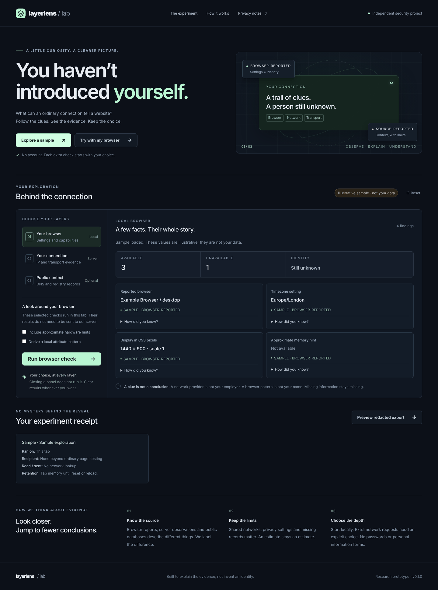

# LayerLens

[](https://github.com/hamimabbu/layerlens/actions/workflows/check.yml)

LayerLens shows what a browser and an ordinary network connection can reveal. Browser checks run in the tab. A small Node.js server handles connection checks and optional public-record lookups.

Each result lists its source, when it was retrieved and what it can tell you. A shared IP address or a network registration record describes a connection, not the person using it.



## Run locally

Requires Node.js 22 or newer. The core app has no package dependencies and needs no API key.

```sh
npm start
```

Open http://127.0.0.1:8787. The server binds to loopback by default.

```sh
npm run check
npm test
```

## What you can try

| Check | How it works |
| --- | --- |
| Sample mode | Shows made-up data without running a lookup. |
| Browser settings | Reads selected settings in the tab after a click. Optional hardware hints can be unavailable in some browsers. |
| Local attribute pattern | Computes a SHA-256 hash of selected browser values. It does not establish a unique identity. |
| Connection check | Returns the socket address or the address supplied by a configured, trusted ingress. |
| Public records | Looks up PTR, RDAP or InternetDB records after the operator enables a source and the visitor selects it. These checks are off by default. |
| Export and reset | Previews a redacted JSON export. Reset clears the tab's results. |
| Transport diagnostic | Supports a separate Fingerproxy endpoint for JA3, JA4 and HTTP/2 metadata. A real TLS deployment still needs testing. |

Browser results stay in the tab. The initial configuration request reads deployment settings; it does not run an address lookup. Missing transport data stays unavailable. In local HTTP mode, the connection report describes the application-side connection.

## Optional public-record lookups

Copy `.env.example` to `.env` and configure the sources you want to enable. For direct Node use:

```sh
node --env-file=.env server/index.mjs
```

- `ENABLE_EXTERNAL_LOOKUPS=true` enables the public-record adapters.
- PTR also needs `DNS_RESOLVERS`.
- InternetDB also needs `ENABLE_INTERNETDB=true`. Its publisher documents free noncommercial use; check the terms before deployment.

The visitor must select a configured source and approve its recipient before the lookup runs. Local, private and reserved addresses are rejected before an external request. InternetDB returns existing indexed records; this app does not scan visitors' services. An empty result does not establish that a connection is safe.

## Optional deployment

```sh
docker compose up --build
```

Compose reads `.env` and passes every setting from `.env.example` to the container, except `HOST` and `PORT`. The container configuration uses a non-root user, a read-only filesystem and dropped capabilities, with a loopback-only published port. The setup was built and run once on Linux with Docker Engine 29.9.2 (see the [validation record](docs/VALIDATION.md)). Test it on the intended host and configure HTTPS before public use.

For transport fingerprints, see the [Fingerproxy setup guide](docs/TRANSPORT.md). The integration uses [wi1dcard/fingerproxy](https://github.com/wi1dcard/fingerproxy), licensed under Apache-2.0. The version reviewed for the guide was v1.2.3.

Use a separate diagnostic hostname with valid HTTPS. The app contacts it only after the transport button is pressed and omits browser cookies. Only trusted proxy peers can supply fingerprint headers. A TLS-terminating CDN changes the connection being measured, so it needs separate consideration during setup.

The server has fixed limits in `server/index.mjs`: request bodies up to 4 KB, 20 API calls per visitor per minute (IPv6 visitors share one allowance per /64 range) and 10 seconds for a request to finish arriving. A public deployment still needs connection and bandwidth limits at its ingress.

## Tests and limits

The automated tests cover address parsing and classification, trusted headers, lookup selection, consent, response limits, redaction, the responses of every route, request and rate limits, and how the page handles server answers it cannot read. GitHub Actions runs them on Node.js 22 and 24. The [validation record](docs/VALIDATION.md) includes the browser checks and remaining gaps.

Live DNS, RDAP and InternetDB accuracy and availability have not been measured. RDAP and InternetDB were tried against the live services in the second test pass. Reverse DNS has only run against a local test server, and real Fingerproxy TLS remains unverified. p0f packet capture is a possible extension and is not implemented.

The app has no results database, analytics SDK, cookies or persistent browser identifiers. Server results last for the request; browser results stay in memory. Hashed rate counters are removed within 61 seconds. Hosting and proxy logs need their own configuration, and reset cannot remove records held by a provider.

Export redaction reduces the information shared, but remaining values can still be identifying. A PTR name is not a private computer name, and a CVE linked to a shared exit IP does not confirm a vulnerability on the visitor's laptop.

## Code

```text
public/                     Page, styles and interface code
public/browser-checks.mjs   Checks that run in the tab
public/content.mjs          Page wording and sample data
public/answers.mjs          Checks server answers before the page shows them
public/report.mjs           Export redaction shared with the server
server/index.mjs            API, consent checks, trusted ingress and quotas
server/evidence.mjs         Address parsing and evidence records
server/collectors.mjs       PTR, RDAP and InternetDB adapters
tests/                      Unit and local integration tests
docs/                       Architecture, setup, sources and test notes
compose.yaml                Container configuration
```

See the [architecture](docs/ARCHITECTURE.md), [threat model](docs/THREAT-MODEL.md) and [sources](docs/SOURCES.md) for more detail. Keep `.env`, certificates, private keys, captures and logs out of Git. Publishing the repository does not deploy the app.

## Licence

LayerLens code is licensed under MIT. Optional tools and datasets keep their own licences and terms. Preserve their notices when distributing their code or binaries.
