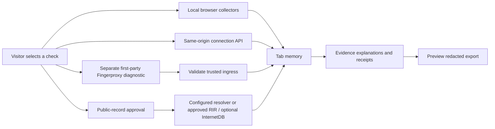

# Architecture

Browser results are never posted to receive a network report. `/api/config` exposes operator policy, not the visitor's address. `/api/connection` processes an explicitly chosen same-origin check. `/api/enrich` derives the connection address itself: there is no arbitrary target parameter.

RDAP uses public IANA bootstrap data cached for one day; only selected approved RIR HTTPS endpoints are permitted. The app never returns arbitrary RDAP contact entities. PTR uses the explicitly configured backend resolver; this does not discover the visitor's DNS configuration. External adapters return partial success and bounded errors.

Each evidence record has `field`, `value`, `source`, `subject`, `kind`, `state`, `retrievedAt`, nullable `sourceObservedAt` and `limitation`. A current retrieval is not evidence of a current historical observation.

Fingerprints and address records remain different subjects. The app does not call a mismatch deception, a bot or a verified OS. Future correlation needs per-connection provenance and ground-truth tests; a public IP alone cannot distinguish multiple browsers behind NAT.

## Data and retention

- Application results: request-scoped on the server; in-memory in the tab.
- Rate limiter: process-keyed HMAC counters, physically removed within 61 seconds; process key is regenerated on restart.
- IANA bootstrap: public reference dataset cached for up to one day.
- No visitor result database, cookies, localStorage, service worker or analytics SDK.
- Hosting, DNS, RIR, optional Shodan and ingress logs remain separate processors/configuration responsibilities.

## Extension decisions

The public-facing build is a small original app rather than a wholesale MyIP fork. MyIP and CreepJS informed the research; no code from them was copied. Optional Fingerproxy is the actual transport integration. Do not stack multiple TLS terminators and assume they all see the original browser.

p0f is a future isolated sensor, not an always-on default. Before implementing it, select the exact v3 API/header definitions, constrain capture to a dedicated experiment, drop capture privileges, test modern signatures and avoid persistent raw captures. The uploaded brief mixed v2 and v3 flags; it is not an installation script.
