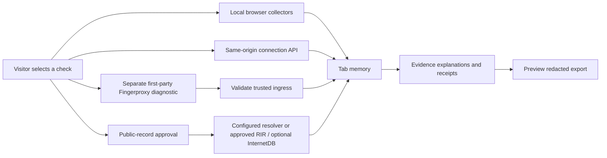

# Architecture

Browser results are never posted to receive a network report. `/api/config` exposes operator policy, not the visitor's address. `/api/connection` processes an explicitly chosen same-origin check. `/api/enrich` derives the connection address itself: there is no arbitrary target parameter.

RDAP uses public IANA bootstrap data cached for one day; only selected approved RIR HTTPS endpoints are permitted. The app never returns arbitrary RDAP contact entities. PTR uses the explicitly configured backend resolver; this does not discover the visitor's DNS configuration. External adapters return partial success and bounded errors.

Each evidence record has `field`, `value`, `source`, `subject`, `kind`, `state`, `retrievedAt`, nullable `sourceObservedAt` and `limitation`. A current retrieval is not evidence of a current historical observation.

Fingerprints and address records remain different subjects. The app does not call a mismatch deception, a bot or a verified OS. Future correlation needs per-connection provenance and ground-truth tests; a public IP alone cannot distinguish multiple browsers behind NAT.

## Page modules

The page is plain ES modules with no build step. `app.mjs` draws the interface and talks to the server. `browser-checks.mjs` holds the checks that run in the tab, `content.mjs` holds the wording and the sample data, `answers.mjs` checks every server answer before the page shows it, and `report.mjs` redacts exports.

An answer with the wrong shape ends in a short error message. Text from the server is cut to 2,000 characters and is only ever shown as text.

## Data and retention

- Application results: request-scoped on the server; in-memory in the tab.
- Rate limiter: process-keyed HMAC counters, physically removed within 61 seconds; process key is regenerated on restart. IPv6 visitors are counted per /64 range, and at most 2,000 visitors are tracked. When that table is full, new visitors get a 429 response until entries expire.
- IANA bootstrap: public reference dataset cached for up to one day.
- No visitor result database, cookies, localStorage, service worker or analytics SDK.
- Hosting, DNS, RIR, optional Shodan and ingress logs remain separate processors/configuration responsibilities.

## Extension decisions

MyIP and CreepJS informed the research; their application code is not included in LayerLens. Fingerproxy is the optional transport integration. A TLS terminator changes the connection seen by the next hop, so the diagnostic ingress needs to receive the browser's connection directly.

p0f is a possible extension and is not implemented. Adding it would need a check of the v3 API and command-line options, a separate capture experiment, reduced capture privileges and tests against current signatures. Raw captures should not be retained by default.
